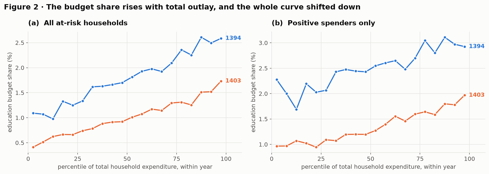
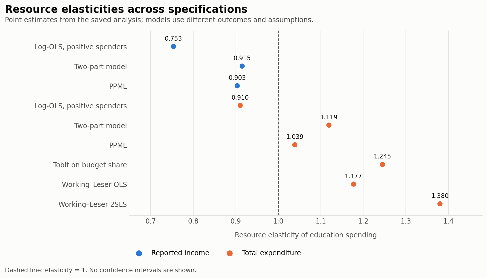
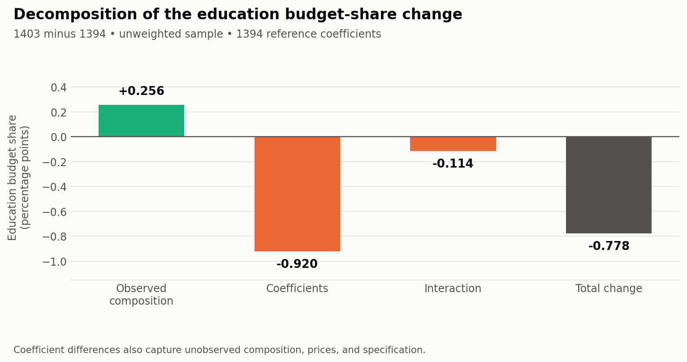

# Household Education Expenditure in Iran, 1394 and 1403

Setayesh Heydari and Bardia Soltani Moakhar  
Econometrics, School of Industrial Engineering, Sharif University of Technology  
Instructor: Dr. Fatemeh Asghari

## Research question

We examine how household resources, family composition, and the number of enrolled students relate to education spending in Iran. We also compare these relationships between the 1394 and 1403 survey waves, approximately 2015–16 and 2024–25.

Three questions guide the analysis: whether education spending rises more or less than proportionally with resources; whether households with more students spend less per student after controlling for resources; and whether the spending relationship differs between the two years. The focus is household spending on education services, rather than the full value of schooling or children's learning outcomes.

## Data and sample

The data come from household summary workbooks for the Statistical Centre of Iran's Household Expenditure and Income Survey. The analysis treats the waves as repeated cross-sections, with no household-level matching. See the [data notes](../data/README.md) for input filenames and provenance.

| Sample step | Households remaining |
|---|---:|
| Both survey waves | 75,757 |
| At least one enrolled student | 36,394 |
| Positive reported income | 36,382 |
| Remaining spending and age checks | 36,382 |
| Positive education spending, for log-OLS | 26,082 |

The main sample contains 19,090 households in 1394 and 17,292 in 1403. Of these, 10,300 report zero education spending: 28.3% of sample households, or 23.1% after applying household survey weights.

The dependent variable is `Education Services`. Resources are measured alternatively by reported annual income and total expenditure. Controls include enrolled students, child count, household size and structure, head's age and sex, head's education and employment group, urban residence, home ownership, province, season, and year. We use education categories because the published years-of-schooling field contains missing and internally inconsistent values.

The family-structure categories are proxies constructed from the number of adults and spouses. In particular, the code's “Single-parent” label means at most one adult under this construction; it is not a separately verified parental-status measure. Enrolled students can include adults, so student count and the number of children under 18 measure different things.

## Empirical approach

The baseline model is

$$
\ln E_{it}=\alpha+\beta\ln R_{it}+\delta\ln N_{it}+\gamma'Z_{it}+\lambda_t+u_{it},
$$

where $E$ is education spending, $R$ is income or total expenditure, $N$ is the number of enrolled students, and $Z$ contains household, location, and season controls. The coefficient $\beta$ describes a conditional elasticity among positive spenders. We build the specification in stages to show how year and household controls change it.

We estimate a two-part model to include households reporting zero. A probit model estimates the probability of positive spending, and log-OLS models spending conditional on a positive amount. A common Duan smearing factor retransforms log predictions. Under that common-factor assumption, the average elasticity is the sum of the log-OLS coefficient and the mean probit participation elasticity. A 300-replicate province block bootstrap supplies an interval for this sum. The common smearing factor is an approximation: if the retransformation factor varies with resources, it can also affect the elasticity.

Additional specifications include PPML on spending levels, a left-censored Tobit on the budget share, and a Working–Leser share equation,

$$
w_i=\alpha+\beta\ln X_i+\gamma'Z_i+u_i,\qquad w_i=E_i/X_i.
$$

For the share equation, we report an elasticity evaluated using the sample mean share, $1+\beta/\bar w$. A 2SLS specification instruments log total expenditure with log income. This comparison depends on an exclusion restriction: conditional on the controls, income must affect the education share only through total expenditure. A strong first stage does not establish that restriction, so the IV estimate does not establish causality or prove that measurement error has been removed.

Most regression inference uses standard errors clustered by province, with 31 clusters. The custom 2SLS covariance calculation uses HC0 standard errors without province clustering; the conventional joint Chow statistic also uses a different variance assumption. Neither should be read as province-clustered inference. The notebook reports a wild cluster bootstrap for the income log-OLS coefficient as an additional check.

## Results

### Education's share of the household budget declined

| Survey-weighted statistic | 1394 | 1403 |
|---|---:|---:|
| Mean education budget share | 2.27% | 1.36% |
| Households reporting zero education spending | 22.3% | 24.0% |
| Enrolled students per household | 1.54 | 1.56 |
| Household size | 4.23 | 4.09 |

The weighted education share declined by 0.91 percentage points, about 40% of its initial value. The unweighted Engel curves also show a lower education share in 1403 across the expenditure-rank bins.

These plots compare relative expenditure positions. Budget shares describe spending allocation, but they do not remove changes in relative education prices or establish a decline in the quantity or quality of education received.

### Including zero spenders changes the income estimate

The income coefficient is 0.7713 in the simplest pooled model, 0.9922 after adding a year indicator, and 0.7532 after adding the full controls. The final income specification has $R^2=0.4925$ on the 26,082 positive spenders.

| Resource measure | Model | Elasticity |
|---|---|---:|
| Reported income | Log-OLS, positive spenders | 0.7532 |
| Reported income | Two-part model | 0.9151 |
| Reported income | PPML | 0.9035 |
| Total expenditure | Log-OLS, positive spenders | 0.9104 |
| Total expenditure | Two-part model | 1.1191 |
| Total expenditure | PPML | 1.0389 |
| Total expenditure | Tobit on the budget share | 1.2451 |
| Total expenditure | Working–Leser OLS | 1.1771 |
| Total expenditure | Working–Leser 2SLS | 1.3803 |

The two-part income estimate combines an intensive margin of 0.7532 and an average participation elasticity of 0.1619. Its bootstrap 95% interval is [0.8247, 1.0235], which includes one. The probit average partial effect is 0.0821: a 10% income difference corresponds approximately to a 0.82 percentage-point difference in the probability of positive spending, holding the model's controls fixed.

Expenditure-based point estimates are generally higher. The estimates span both sides of one, and the models use different outcomes, resource measures, and assumptions. Their ordering is useful for assessing sensitivity, but it does not prove a single underlying “true” elasticity or distinguish short-run from long-run effects.

### The pooled per-student estimate is inconclusive

The student-count coefficients in the total-spending and per-student regressions satisfy $\delta_{ps}=\delta_{total}-1$ by construction. With income as the resource control, the per-student coefficient is 0.0044 ($p=0.9081$). With total expenditure it is −0.0629 ($p=0.1066$).

| Within-year expenditure tercile | Per-student elasticity | Province-clustered SE | p-value |
|---|---:|---:|---:|
| Bottom third | −0.1372 | 0.0563 | 0.0148 |
| Middle third | −0.0174 | 0.0554 | 0.7536 |
| Top third | −0.0426 | 0.0483 | 0.3781 |

The bottom-third estimate is negative and significant at 5%. This is consistent with tighter budgets in that group, but separate significance tests do not establish that the three coefficients differ from each other. Student numbers are also household choices, so the result is descriptive.

### Differences between waves extend beyond household composition

The conventional joint Chow test rejects equal slopes, $F(23,26001)=9.78$. This statistic is not adjusted for province clustering. Individual interactions use clustered standard errors: the income interaction is +0.1071 (SE 0.0727, $p=0.1405$). We therefore do not find a statistically significant income-slope difference in that specification; this does not establish that the slopes are identical.

An unweighted Oaxaca–Blinder decomposition of the budget-share change gives +0.256 percentage points for observed composition, −0.920 for coefficients, and −0.114 for their interaction, summing to −0.778 after rounding. Its means and regression models are unweighted, so this change differs from the weighted −0.91 percentage-point change above.

Observed composition offsets part of the decline in this decomposition. The coefficient component also absorbs unobserved composition, prices, and model specification; it cannot be attributed entirely to preferences or household behaviour.

## Diagnostics and sensitivity

The notebook reports RESET, Breusch–Pagan, White, Jarque–Bera, VIF, and residual plots. RESET rejects the baseline functional form at 5% ($p=0.0324$); adding a squared log-income term changes fit little. Heteroskedasticity and residual non-normality are detected. For the income coefficient, the province-clustered standard error is 1.84 times the classical standard error. A large household count alone does not resolve uncertainty from having only 31 clusters.

Excluding Tehran, trimming the top 1% of education budget shares, and changing the schooling control give two-part income elasticities of 0.8978, 0.9302, and 0.9330. Removing the student restriction gives 1.2080 and changes the population described. Survey-weighting only the intensive margin gives 1.0742 when combined with the original unweighted extensive margin; this is a partial weighting check, not a fully weighted two-part estimate. The quadratic Working–Leser estimate of 1.1850 is closest in interpretation to the linear share-equation estimate of 1.1771.

## Limits and further work

The analysis measures associations in two repeated cross-sections. Unobserved preferences, reporting errors, and selection into the enrolled-student sample remain concerns. Income and total expenditure are imperfect resource measures, and the exclusion restriction behind 2SLS cannot be verified here. Province clustering is an approximation rather than a complete implementation of the survey design.

Zero recorded spending can coexist with public schooling and substantial parental time. Spending per student is a household average, with no information about allocation between children. These data therefore cannot establish learning outcomes, child-level inequality, or the effect of a particular policy.

Intermediate waves would show when the budget-share decline occurred. Child-level enrolment and school-type information would help separate changes in paid services from substitution toward public schooling.

## References

- Statistical Centre of Iran. *Household Expenditure and Income Survey*, 1394 and 1403; household summary workbooks described in the data notes.
- Becker, G. S., and Lewis, H. G. (1973). “On the Interaction between the Quantity and Quality of Children.” *Journal of Political Economy*, 81(2).
- Duan, N. (1983). “Smearing Estimate: A Nonparametric Retransformation Method.” *Journal of the American Statistical Association*, 78(383).
- Santos Silva, J. M. C., and Tenreyro, S. (2006). “The Log of Gravity.” *Review of Economics and Statistics*, 88(4).
- Solon, G., Haider, S. J., and Wooldridge, J. M. (2015). “What Are We Weighting For?” *Journal of Human Resources*, 50(2).
- Wooldridge, J. M. *Introductory Econometrics: A Modern Approach*. Cengage.
